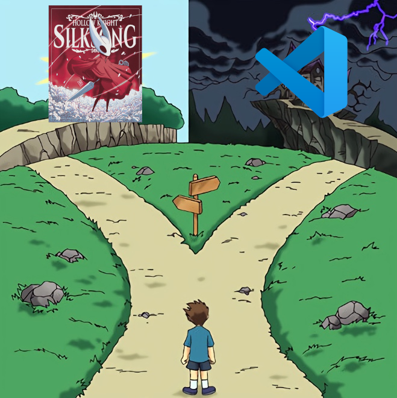

# Hi there

I am a Python Backend Developer. Check out my projects:

## MyBeerList

An app to manage beer catalog and reviews aka Untapped analog. Still in progress.

https://mybeerlistdev.falser.dev/

## AirStrafer

A s1mple trainer to sync CS2 air strafes (mouse + keyboard correct movement)

https://air-strafer.falser.dev/

##

